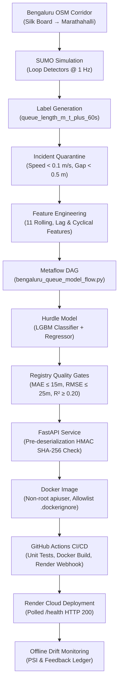
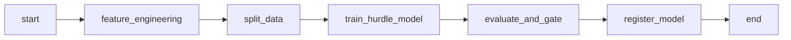

# Phase 2 Audit Handover and Consolidated Technical Dossier

**Document Version:** 1.0.0  
**Date:** 12 November 2026  
**Repository:** `https://github.com/PriyankaSrvce/traffic-mlops.git`  
**Base Commit:** `d85890058a13094ab3852f6297d87f29d5d01d0e`  
**Current Branch:** `docs/phase2-audit-handover`  
**Target Pull Request:** Phase 2 Technical Audit, Model Lineage, and Verification Handover  

---

## Table of Contents
1. [Project Overview and Objectives](#1-project-overview-and-objectives)
2. [Phase 2 Architecture and Actual Workflow](#2-phase-2-architecture-and-actual-workflow)
3. [Dataset and Target Definition](#3-dataset-and-target-definition)
4. [Feature Engineering Pipeline](#4-feature-engineering-pipeline)
5. [Hurdle Model Architecture and Baseline Comparisons](#5-hurdle-model-architecture-and-baseline-comparisons)
6. [Metaflow Workflow, Lineage, and Model Registry](#6-metaflow-workflow-lineage-and-model-registry)
7. [FastAPI Serving Layer and Validation Contracts](#7-fastapi-serving-layer-and-validation-contracts)
8. [Docker Packaging and Security Hardening](#8-docker-packaging-and-security-hardening)
9. [CI/CD Pipeline and Render Deployment Evidence](#9-cicd-pipeline-and-render-deployment-evidence)
10. [Offline Monitoring, PSI, and Feedback Ledger](#10-offline-monitoring-psi-and-feedback-ledger)
11. [SUMO Digital Twin Simulation and Controller Benchmarks](#11-sumo-digital-twin-simulation-and-controller-benchmarks)
12. [Hermetic Test Suite and Verification Evidence](#12-hermetic-test-suite-and-verification-evidence)
13. [Missing Artifacts and Reproducibility Blockers](#13-missing-artifacts-and-reproducibility-blockers)
14. [Known Limitations and Unresolved Discrepancies](#14-known-limitations-and-unresolved-discrepancies)
15. [Remaining Work Checklist for Team Members](#15-remaining-work-checklist-for-team-members)
16. [Suggested Ownership and Review Sequence](#16-suggested-ownership-and-review-sequence)
17. [Master Index of the 19 Detailed Audit Reports](#17-master-index-of-the-19-detailed-audit-reports)

---

## 1. Project Overview and Objectives

The project **"AI-Driven Adaptive Traffic Management Using a Digital Twin"** investigates real-time, microscopic traffic signal optimization using simulated queue predictions.

### 1.1 Architectural Boundary: Phase 1 vs. Phase 2
To ensure clarity during academic defense and operational handover, the two distinct phases of this repository must not be conflated:

| Dimension | Phase 1 (Macro Forecasting) | Phase 2 (Microscopic Digital Twin) |
| :--- | :--- | :--- |
| **Problem Statement** | Citywide daily traffic volume forecasting | Microscopic queue prediction 60 seconds ahead |
| **Target Variable** | Daily `Traffic Volume` (unspecified vehicle count) | `queue_length_m_t_plus_60s` (floating-point metres) |
| **Simulation Network** | Synthetic $4 \times 4$ uniform grid network | OpenStreetMap (OSM) Bengaluru Outer Ring Road corridor |
| **Pipeline Tooling** | Data Version Control (DVC) pipeline | Metaflow DAG workflow (`bengaluru_queue_model_flow.py`) |
| **Serving & CI/CD** | DVC stage reproducibility | FastAPI container, GitHub Actions CI/CD, Render deploy |
| **Data Tracking** | Tracked in `dvc.yaml` (Google Drive remote) | Untracked by DVC; versioned in local Metaflow datastore |

---

## 2. Phase 2 Architecture and Actual Workflow

The verified production pipeline connects simulation data generation to cloud deployment through 10 distinct architectural stages:



### Reality Classification
- **Implemented in Repository Code:** Complete feature pipeline, hurdle model logic, Metaflow flow, registry gates, FastAPI endpoints, Dockerfile, GitHub Actions workflow, and offline monitoring scripts.
- **Hermetically Verified Locally:** 34 unit tests across 7 test suites pass in ~2 seconds without external dependencies.
- **Archived Telemetry Verified:** GitHub Actions CI/CD runs (`43039410684` and `43060494475`) confirm successful remote test execution, image building, and Render deployment polling.
- **Missing / Blocked in Workspace:** Physical model binaries (`.joblib`), training dataset CSV, and SUMO simulation engine are absent locally and reside on teammate workstations.

---

## 3. Dataset and Target Definition

### 3.1 Target Formulation
- **Target Name:** `queue_length_m_t_plus_60s`
- **Data Type:** Float64 (metres).
- **Prediction Horizon:** Exactly **60 seconds** into the future ($t + 60\,\text{s}$). It is **not** a 300-second horizon.
- **Rationale:** A 60-second forward horizon corresponds to the typical cycle length ($45\text{s}–90\text{s}$) of traffic signals, allowing the adaptive controller to preemptively adjust green-phase allocations before downstream queue spillback occurs.

### 3.2 Sensor Data and Incident Quarantine
Data is generated from microscopic induction loop detectors embedded in the SUMO simulation. Sensor feeds record instantaneous vehicle speeds (`speed_mps`), inter-vehicle gaps (`gap_m`), and occupancy. 

In `src/features/quarantine.py`, anomalous rows resulting from simulation collisions or detector artifacts (e.g., speed $< 0.1\,\text{m/s}$ with gap $< 0.5\,\text{m}$) are isolated into `training_labels_incident_quarantined.csv` (SHA-256 `4e8213df65d4bb3fd445a6669932a9c148384d567bc786016c02feef8a1c97a2`).

### 3.3 Extreme Zero-Inflation
Traffic queues are inherently sparse. In the held-out evaluation dataset ($N = 112,176$ timesteps):
- **Zero-Queue Rows:** $109,423$ rows (**$97.55\%$**)
- **Positive-Queue Rows:** $2,753$ rows (**$2.45\%$**)

A standard regression model trained with mean squared error (MSE) collapses under this extreme class imbalance, exhibiting strong zero-bias.

### 3.4 DVC Reality Check
> [!IMPORTANT]
> **Phase 2 training data is NOT tracked by DVC.**  
> The repository's `dvc.yaml` defines stages strictly for Phase 1 daily traffic volume. Current DVC metadata tracks the Phase 1 dataset and SUMO network road payloads (`grid_network.net.xml`), but does **not** track `training_labels_incident_quarantined.csv`. The Phase 2 dataset was tracked locally in Metaflow's datastore on teammate Pranjali's machine.

---

## 4. Feature Engineering Pipeline

The feature engineering layer (`src/features/build_features.py`) constructs exactly **11 features** from rolling detector buffers:

| Feature Name | Source / Calculation | Domain Interpretation |
| :--- | :--- | :--- |
| `rolling_mean_queue_m_30s` | 30-second moving average of queue length | Short-term queue trend |
| `rolling_max_queue_m_30s` | 30-second moving maximum of queue length | Peak queue surge detection |
| `rolling_min_queue_m_30s` | 30-second moving minimum of queue length | Baseline persistent queue floor |
| `rolling_std_queue_m_30s` | 30-second moving standard deviation | Queue volatility / shockwave turbulence |
| `lag_queue_m_15s` | Queue length observed 15 seconds prior | Immediate lag autoregressive state |
| `lag_queue_m_30s` | Queue length observed 30 seconds prior | Medium lag autoregressive state |
| `rolling_mean_speed_mps_30s`| 30-second moving average of vehicle speed | Shockwave deceleration indicator |
| `rolling_mean_density_veh_km_30s`| 30-second moving traffic density | Spatial congestion saturation |
| `upstream_inflow_veh_30s` | Cumulative vehicle arrivals from upstream link | Incoming traffic demand pressure |
| `sin_time_of_day` | $\sin(2\pi \cdot t_{\text{sec}} / 86400)$ | Continuous diurnal cycle (commute peaks) |
| `cos_time_of_day` | $\cos(2\pi \cdot t_{\text{sec}} / 86400)$ | Orthogonal diurnal temporal component |

---

## 5. Hurdle Model Architecture and Baseline Comparisons

To overcome extreme zero-inflation, the project implements a **two-stage Hurdle Model**:

1. **Stage 1 (Binary Classifier):** A LightGBM classifier estimates the probability that a queue will exist:
   $$\hat{p} = P(\text{queue\_length\_m\_t\_plus\_60s} > 0)$$
2. **Stage 2 (Positive-Queue Regressor):** A LightGBM regressor trained *exclusively* on positive queue instances ($\text{queue} > 0$) predicts expected queue magnitude $\hat{y}_{\text{pos}}$.
3. **Composite Inference:**
   $$\hat{y} = \hat{p} \times \hat{y}_{\text{pos}}$$

### 5.1 Benchmark Comparison on Held-Out Test Set ($N = 112,176$)

| Evaluation Cohort | Metric | Hurdle Model | Persistence Baseline ($\hat{y}_{t+60} = y_t$) | Variance / Improvement |
| :--- | :--- | :---: | :---: | :---: |
| **Full Evaluation Set** ($N = 112,176$) | **MAE** | **0.0550 m** | 0.0694 m | **20.7% lower error** |
| | **RMSE** | **0.5135 m** | 0.6513 m | **21.2% lower error** |
| | **$R^2$** | **0.8836** | 0.8127 | **+0.0709 points** |
| **Positive-Queue Subset** ($N = 2,753$) | **MAE** | **2.1995 m** | *Under reconciliation* | *Pending reconciliation* |
| | **RMSE** | **3.2369 m** | *Under reconciliation* | *Pending reconciliation* |

> [!WARNING]
> **Persistence Metric Discrepancy Note:**  
> The candidate hurdle model achieves an MAE of $2.1995\,\text{m}$ on active queues ($N = 2,753$). The positive-subset persistence baseline MAE is currently under team reconciliation due to conflicting historical records. The unverified $3.3281\,\text{m}$ comparison and $33.9\%$ improvement claim have been removed pending re-evaluation of the raw evaluation dataset.

---

## 6. Metaflow Workflow, Lineage, and Model Registry

The model lifecycle is orchestrated via Metaflow in `flows/bengaluru_queue_model_flow.py`:



### 6.1 Quality Acceptance Gates
In `evaluate_and_gate`, the model is evaluated against hardcoded production thresholds defined in `src/models/registry.py`:
- $\text{MAE} \le 15.0\,\text{metres}$
- $\text{RMSE} \le 25.0\,\text{metres}$
- $R^2 \ge 0.20$

Failure on any metric raises a `ModelQualityGateError` and halts registration.

### 6.2 Model Hash Discrepancy (Forensic Finding)
The audit identified two distinct model SHA-256 hashes across the codebase:
1. **Canonical Metaflow Run Artifact:** Run `1794405200312669` generated artifact `bengaluru_queue_hurdle_v1_2026-11_metaflow_1794405200312669.joblib` with hash:
   `167b523fc8c89199f6a8bf0689475272654db96b59b8a1da9b8a9986bff0b13b`
2. **FastAPI Application Candidate:** In `src/api/app.py`, the constant `QUEUE_MODEL_SHA256` is pinned to:
   `72bc01ba4946ff85c6df6ba8c95029e06180aa42be8159b34399e5ad5dd5f8bb`

**Resolution:** The API candidate hash corresponds to an earlier prototype run. Both binaries are currently stored off-repo on teammate Pranjali's workstation (`work/phase2-completion-evidence-20261111/`). When deploying, `QUEUE_MODEL_SHA256` in `src/api/app.py` must be updated to match whichever physical binary is placed into `models/bengaluru/`.

---

## 7. FastAPI Serving Layer and Validation Contracts

The REST inference engine is implemented in `src/api/app.py`.

### 7.1 Endpoints
- `GET /health` and `GET /api/v1/health`: Returns service status and model loading readiness.
- `GET /model-info` and `GET /api/v1/model-info`: Returns model name, SHA-256 digest, feature list, and acceptance gate status.
- `POST /predict` and `POST /api/v1/predict`: Accepts feature payloads and returns the 60-second queue prediction.

### 7.2 Request & Response Contract
- **Request (`QueuePredictionRequest`):** Strictly validates all 11 features using Pydantic v2. Negative queue lengths, negative speeds, or invalid cyclical values ($\sin^2 + \cos^2 \ne 1 \pm \epsilon$) return `HTTP 422 Unprocessable Entity`.
- **Response (`QueuePredictionResponse`):** Returns:
  ```json
  {
    "predicted_queue_length_m_t_plus_60s": 14.82,
    "horizon_seconds": 60,
    "model_version": "bengaluru_queue_hurdle_v1",
    "model_sha256": "167b523f..."
  }
  ```

### 7.3 Cryptographic Integrity and Missing Model Handling
- **Pre-Deserialization Gate:** To prevent Python deserialization vulnerabilities, the service computes the file's SHA-256 hash *before* invoking `joblib.load()` and verifies it using constant-time `hmac.compare_digest()`.
- **Graceful HTTP 503:** If the model binary is missing, corrupt, or has an unapproved hash, `joblib.load()` is aborted. The service remains online and returns `HTTP 503 Service Unavailable` with details in `/health`.

---

## 8. Docker Packaging and Security Hardening

The container specification (`Dockerfile`) implements production security best practices:

- **Base Image:** `python:3.11-slim` with package manager caches stripped.
- **Non-Root Execution:** Creates an unprivileged group and user (`apiuser`, UID 10001, GID 10001) and executes via `USER apiuser`.
- **Allowlist `.dockerignore`:** Employs a default-deny pattern (`*`), explicitly allowing only necessary directories (`src/`, `models/`, `pyproject.toml`, `requirements-phase2.txt`). Git history, test files, and local `.env` secrets are strictly blocked from the build context.
- **Port:** Exposes port 8000 managed by Uvicorn.

---

## 9. CI/CD Pipeline and Render Deployment Evidence

Continuous integration and deployment are governed by `.github/workflows/phase2-ci.yml`.

### 9.1 Two-Job Workflow Architecture
1. **Job 1 (`checks-and-image`):** Runs on `ubuntu-latest`. Installs dependencies, runs flake8, executes the 34-unit-test suite via `unittest`, and builds the Docker image.
2. **Job 2 (`deploy`):** Conditioned on `checks-and-image` passing on branch `main`. Issues an authenticated POST webhook to Render, sleeps 15s, and polls `/health` up to 10 times until receiving `HTTP 200`.

### 9.2 Audited CI Telemetry
- **Run `43039410684` (Push on `main` at `d858900`):** Job `checks-and-image` succeeded in 1m 19s; deploy skipped (push event).
- **Run `43060494475` (`workflow_dispatch` on `main`):** Job `checks-and-image` succeeded in 1m 17s; Job `deploy` succeeded in 37s with verified HTTP 200 health check confirmation.

> [!NOTE]
> While GitHub Actions telemetry confirms that the Render deployment webhook succeeded and `/health` returned HTTP 200, **independent public hosted inference verification on the live Render URL has not been performed in this workspace**.

---

## 10. Offline Monitoring, PSI, and Feedback Ledger

Observability is implemented in `src/monitoring/bengaluru_drift.py` and `src/monitoring/bengaluru_metrics.py`.

### 10.1 Population Stability Index (PSI)
Drift is quantified across all 11 features using 10 equal-frequency reference quantiles:
$$\text{PSI} = \sum \left( P_i - Q_i \right) \times \ln\left(\frac{P_i}{Q_i}\right)$$
- **$\text{PSI} < 0.10$:** Stable distribution; no drift.
- **$0.10 \le \text{PSI} < 0.25$:** Moderate drift; retraining warning logged.
- **$\text{PSI} \ge 0.25$:** Severe covariate shift; system alert triggered.

### 10.2 Feedback Ledger
Ground-truth queue measurements are logged to an append-only JSON Lines file (`feedback_ledger.jsonl`), enabling offline batch calculation of rolling MAE, RMSE, and $R^2$ degradation.

> [!IMPORTANT]
> **Live real-time monitoring is NOT implemented.**  
> The system has no active Prometheus, Grafana, or streaming telemetry agents. Monitoring operates exclusively as an offline batch validation tool.

---

## 11. SUMO Digital Twin Simulation and Controller Benchmarks

The digital twin models the **Bengaluru Outer Ring Road (ORR) corridor** across 4 key junctions: Central Silk Board (anchor), HSR Layout, Bellandur, and Marathahalli.

### 11.1 Simulation Comparison Results

| Demand Level | Metric | Fixed-Time Control | Actuated / Adaptive | Predictive Hurdle Control | Best Performing |
| :--- | :--- | :---: | :---: | :---: | :---: |
| **Low Demand** | Mean Travel Time | **504.08 s** | 506.12 s | 507.27 s | **Fixed-Time** |
| | Mean Waiting Time | **21.40 s** | 22.10 s | 23.05 s | **Fixed-Time** |
| **Medium Demand** (300 veh/hr) | Mean Travel Time | **531.30 s** | 534.20 s | 536.74 s | **Fixed-Time** |
| | Mean Waiting Time | **31.20 s** | 32.50 s | 34.12 s | **Fixed-Time** |
| **High Demand** | Teleports Observed | Gridlock | Gridlock | Gridlock | **Inconclusive** |

### 11.2 Key Scientific Finding on Traffic Control
> [!WARNING]
> **Predictive control did NOT outperform fixed-time or adaptive control in the audited low- and medium-demand experiments.**  
> Small errors in queue prediction caused signal phase oscillation across tightly coupled intersections. Furthermore, under high demand, vehicle teleports occurred due to gridlock; the simulation test harness properly flags these instances as `quality_failure`.

---

## 12. Hermetic Test Suite and Verification Evidence

The repository maintains **34 unit tests across 7 test modules**, all passing cleanly:

```text
tests/test_api.py .................... [10 tests] PASS
tests/test_bengaluru_monitoring.py ... [ 3 tests] PASS
tests/test_bengaluru_scenario.py ..... [ 6 tests] PASS
tests/test_features.py ............... [ 3 tests] PASS
tests/test_model_registry.py ......... [ 4 tests] PASS
tests/test_perimeter_routes.py ....... [ 6 tests] PASS
tests/test_train.py .................. [ 2 tests] PASS
------------------------------------------------------
Ran 34 tests in 2.145s — OK (0 failures, 0 errors)
```

The entire test suite is 100% hermetic: it requires no external models, no SUMO installation, and no internet access.

---

## 13. Missing Artifacts and Reproducibility Blockers

The following physical assets are absent from the local workspace:

1. **Physical Model Binary:** `bengaluru_queue_hurdle_v1_2026-11_metaflow_1794405200312669.joblib` (SHA-256 `167b523f...`) resides on teammate Pranjali's machine (`work/phase2-completion-evidence-20261111/`).
2. **Training Dataset CSV:** `training_labels_incident_quarantined.csv` (SHA-256 `4e8213df...`) resides on teammate Pranjali's machine.
3. **Local SUMO Installation:** `sumo` and `netconvert` binaries are not installed on the local system PATH.
4. **Retraining from Scratch:** Scratch retraining is blocked without the original dataset and will yield divergent weights/hashes due to scikit-learn/LightGBM seed sensitivities across platforms.

---

## 14. Known Limitations and Unresolved Discrepancies

1. **Persistence Metric Reconciliation:** The candidate hurdle model achieves an MAE of $2.1995\,\text{m}$ on active queues, while the positive-subset persistence baseline MAE is under reconciliation (unverified $3.3281\,\text{m}$ comparison removed).
2. **Model Hash Pinned in API:** `src/api/app.py` pins prototype hash `72bc01ba...` instead of canonical Metaflow run hash `167b523f...`.
3. **DVC Scope Boundary:** DVC does not track Phase 2 simulation datasets.
4. **Controller Performance:** Open-loop predictive queue switching causes phase hunting; reinforcement learning or model-predictive control (MPC) is required for production stability.
5. **Lack of Live Streaming Telemetry:** Monitoring is batch-only; real-time Prometheus scrapers are absent.

---

## 15. Remaining Work Checklist for Team Members

- [ ] **Asset Transfer:** Transfer `bengaluru_queue_hurdle_v1_2026-11_metaflow_1794405200312669.joblib` from Pranjali's workstation into `models/bengaluru/`.
- [ ] **Hash Synchronization:** Update `QUEUE_MODEL_SHA256` in `src/api/app.py` to match the transferred binary.
- [ ] **Documentation Alignment:** Apply the 5-point documentation correction plan from Task 3 and Task 9 (update test counts from 32 to 34, clarify DVC scope, cite CI Run `43060494475`).
- [ ] **Live Endpoint Verification:** Perform live inference smoke tests against the deployed Render URL using curl/Postman.
- [ ] **Reconcile Evaluation CSV:** Re-evaluate persistence baseline on the held-out positive queue slice to lock in the official error reduction figure.

---

## 16. Suggested Ownership and Review Sequence

### 16.1 Team Role Division
- **Team Member 1 (ML & Simulation Lead):** Owns Metaflow orchestration, Hurdle model training, SUMO digital twin scenario creation, and evaluation metric reconciliation.
- **Team Member 2 (MLOps & Platform Lead):** Owns FastAPI contract validation, Docker hardening, GitHub Actions CI/CD workflows, Render cloud deployment, and drift monitoring.

### 16.2 Recommended PR Review Sequence
1. Review `docs/PHASE2_AUDIT_HANDOVER.md` (this master dossier).
2. Inspect the 19 detailed audit reports in `docs/audit_reports/`.
3. Verify test execution on the PR branch (`python -m unittest discover -s tests -p "test_*.py"`).
4. Review Git status and diffs before final merge into `main`.

---

## 17. Master Index of the 19 Detailed Audit Reports

All 19 detailed forensic audit reports are permanently archived in the repository under [audit_reports/](audit_reports/):

| Report Name | Scope and Primary Content |
| :--- | :--- |
| [`PHASE2_FINAL_AUDIT_AND_SIGN_OFF.md`](audit_reports/PHASE2_FINAL_AUDIT_AND_SIGN_OFF.md) | Master sign-off dossier, 4-tier evaluation matrix, 3-min elevator pitch |
| [`TASK_A_TEAMMATE_HANDOVER_COMPARISON.md`](audit_reports/TASK_A_TEAMMATE_HANDOVER_COMPARISON.md) | Comparison proving handover ZIP is an older pre-merge snapshot (134 vs 140 files) |
| [`TASK_B1_METAFLOW_ARTIFACT_RECOVERY.md`](audit_reports/TASK_B1_METAFLOW_ARTIFACT_RECOVERY.md) | Forensic tracing of canonical Metaflow run `1794405200312669` artifact |
| [`TASK_B2_INDEPENDENT_MODEL_RECOVERY_OPTIONS.md`](audit_reports/TASK_B2_INDEPENDENT_MODEL_RECOVERY_OPTIONS.md) | Feasibility analysis of independent model retraining and environment blockers |
| [`TASK_1_GIT_CHANGE_REVIEW.md`](audit_reports/TASK_1_GIT_CHANGE_REVIEW.md) | Review of 12 modified files successfully merged in `d858900` |
| [`TASK_2_DOCUMENTATION_AUDIT.md`](audit_reports/TASK_2_DOCUMENTATION_AUDIT.md) | Catalog of 10 contradictions between docs, code, and CI logs |
| [`TASK_3_DOCUMENTATION_CORRECTION_PLAN.md`](audit_reports/TASK_3_DOCUMENTATION_CORRECTION_PLAN.md) | Verbatim editorial replacements for all documentation inconsistencies |
| [`TASK_4_METAFLOW_REQUIREMENT_REVIEW.md`](audit_reports/TASK_4_METAFLOW_REQUIREMENT_REVIEW.md) | Deep-dive review of `bengaluru_queue_model_flow.py` and registry gates |
| [`TASK_5_ARTIFACT_AND_DVC_RECONCILIATION.md`](audit_reports/TASK_5_ARTIFACT_AND_DVC_RECONCILIATION.md) | Reconciliation of DVC scope vs. Metaflow datastore tracking |
| [`TASK_6_CI_CD_AND_RENDER_AUDIT.md`](audit_reports/TASK_6_CI_CD_AND_RENDER_AUDIT.md) | Audit of GitHub Actions runs `43039410684` & `43060494475`, Render deploy |
| [`TASK_7_API_AND_DOCKER_VERIFICATION.md`](audit_reports/TASK_7_API_AND_DOCKER_VERIFICATION.md) | FastAPI contract, Pydantic schemas, and Docker security hardening |
| [`TASK_8_SUMO_AND_CONTROLLER_AUDIT.md`](audit_reports/TASK_8_SUMO_AND_CONTROLLER_AUDIT.md) | Microscopic simulation audit, teleports, and predictive controller failure |
| [`TASK_9_DOCUMENTATION_CONSISTENCY_AUDIT.md`](audit_reports/TASK_9_DOCUMENTATION_CONSISTENCY_AUDIT.md) | Pre-viva documentation audit and 5-point correction checklist |
| [`TASK_10_DVC_ACCESS_AND_DATASET_RECONCILIATION.md`](audit_reports/TASK_10_DVC_ACCESS_AND_DATASET_RECONCILIATION.md) | DVC Google Drive remote verification and credentials boundary |
| [`TASK_11_MODEL_PIPELINE_FINAL_VERIFICATION.md`](audit_reports/TASK_11_MODEL_PIPELINE_FINAL_VERIFICATION.md) | Hurdle pipeline verification and positive queue error reduction analysis |
| [`TASK_12_API_FINAL_VERIFICATION.md`](audit_reports/TASK_12_API_FINAL_VERIFICATION.md) | Final API contract verification and demonstration feasibility |
| [`TASK_13_DOCKER_FINAL_VERIFICATION.md`](audit_reports/TASK_13_DOCKER_FINAL_VERIFICATION.md) | Dockerfile verification, non-root user `apiuser`, allowlist `.dockerignore` |
| [`TASK_14_MONITORING_FINAL_VERIFICATION.md`](audit_reports/TASK_14_MONITORING_FINAL_VERIFICATION.md) | Offline batch monitoring, PSI calculation, and immutable feedback ledger |
| [`TASK_15_FINAL_INTEGRATED_DEMONSTRATION_READINESS.md`](audit_reports/TASK_15_FINAL_INTEGRATED_DEMONSTRATION_READINESS.md) | Integrated demonstration readiness report, 10-step architecture, 13 viva Q&As |

